<p align="center">
  
</p>

# Agent Toolkit Index

<sub>Maintained by [@bugaeff](https://github.com/bugaeff)</sub>

A curated, purpose-driven index of skills, hooks, rules, and agents for **Claude Code**: built, tested, and used in real projects.

This is not a link dump. Every entry has a purpose, a status, and a verdict. Our own components are written from scratch after studying several community approaches and the official documentation. Only what we have tested or actually use makes it into this index.

---

## How This Index Works

| Principle | What it means |
| --- | --- |
| **Purpose first** | Entries are grouped by the problem they solve, not by file type (skill, hook, plugin). |
| **Synthesis, not copying** | For each topic we study 2 to 5 community implementations plus official docs, then write our own version. |
| **Dogfooding** | Nothing is listed unless we have tested it or use it in our own projects. |
| **Honest references** | Official Anthropic material and well-known work is linked as-is, with clear attribution. |

### Status Legend

| Status | Meaning |
| --- | --- |
| **TESTED** | Verified in a test project. Works as described. |
| **IN USE** | Running in our real projects. Battle-proven. |
| **REFERENCE** | External work we link to as-is: official docs, recognized authors, or tools we use as a dependency. |

---

## Lifecycle Map

The same catalog, viewed by when each component helps during an agent's work. Numbers point to catalog sections below.

```
+------------------------------------------------------------------+
|  OUTPUT    What the agent produces                               |
|            9.1  9.2  9.3  9.4  9.5  9.6  9.7                     |
+------------------------------------------------------------------+
|  AROUND    Running and watching                                  |
|            5.1  5.2  5.3  5.4  5.5  7.1  7.2                     |
+------------------------------------------------------------------+
|  AFTER     Proving and shipping the result                       |
|            1.4  2.4  6.1  6.2  6.3                               |
+------------------------------------------------------------------+
|  DURING    Doing the work                                        |
|            2.1  2.2  2.3  3.1  3.2  3.3  3.4  4.1  4.2  4.3  4.4 |
+------------------------------------------------------------------+
|  BEFORE    Getting ready to work                                 |
|            1.1  1.2  1.3  1.5  8.1                               |
+------------------------------------------------------------------+
|  META      Maintaining the toolkit itself                        |
|            2.5  8.2  8.3  10                                     |
+------------------------------------------------------------------+
```

---

## Official & Notable References

Primary sources. When community advice and official documentation disagree, official documentation wins.

### Anthropic Documentation

| Resource | Description |
| --- | --- |
| [Claude Code Docs](https://docs.anthropic.com/en/docs/claude-code) | Official Claude Code documentation: setup, hooks, skills, settings, plugins. |
| [Claude Developer Docs](https://docs.claude.com) | Claude API, Agent SDK, and platform documentation. |

### Anthropic Official Repositories

| Repository | Description |
| --- | --- |
| [anthropics/claude-code](https://github.com/anthropics/claude-code) | Claude Code itself: releases, issues, changelog. |
| [anthropics/skills](https://github.com/anthropics/skills) | Official Agent Skills repository, the reference format for skills. |
| [anthropics/claude-plugins-official](https://github.com/anthropics/claude-plugins-official) | Anthropic-managed directory of Claude Code plugins. |
| [anthropics/knowledge-work-plugins](https://github.com/anthropics/knowledge-work-plugins) | Plugins for knowledge work in Claude Cowork and Claude Code. |
| [anthropics/financial-services](https://github.com/anthropics/financial-services) | Reference agents and skills; a model of one source deployed as both plugin and cloud agent. |
| [anthropics/claude-cookbooks](https://github.com/anthropics/claude-cookbooks) | Notebooks and recipes for building with Claude. |
| [anthropics/claude-code-action](https://github.com/anthropics/claude-code-action) | Claude Code as a GitHub Action for PRs and issues. |
| [anthropics/claude-code-security-review](https://github.com/anthropics/claude-code-security-review) | Security review of code changes as a GitHub Action. |
| [anthropics/claude-code-sdk-python](https://github.com/anthropics/claude-code-sdk-python) | Official Python SDK for Claude Code. |

### Notable Community Work

| Resource | Description |
| --- | --- |
| [andrej-karpathy-skills](https://github.com/forrestchang/andrej-karpathy-skills) | A single CLAUDE.md derived from Andrej Karpathy's public observations on LLM coding pitfalls. |

---

## Catalog

### 1. Agent Behavior & Discipline

#### 1.1 Core instructions (CLAUDE.md kernels)
| Name | Purpose | Based on | Status |
| --- | --- | --- | --- |

#### 1.2 Workflow methodology (assess → plan → execute → verify)
| Name | Purpose | Based on | Status |
| --- | --- | --- | --- |

#### 1.3 Planning & task tracking
| Name | Purpose | Based on | Status |
| --- | --- | --- | --- |

#### 1.4 Verification & self-review
| Name | Purpose | Based on | Status |
| --- | --- | --- | --- |

#### 1.5 Anti-hallucination & source checking
| Name | Purpose | Based on | Status |
| --- | --- | --- | --- |

### 2. Safety & Security

#### 2.1 Destructive command guards
| Name | Purpose | Based on | Status |
| --- | --- | --- | --- |

#### 2.2 Secret protection
| Name | Purpose | Based on | Status |
| --- | --- | --- | --- |

#### 2.3 Permission templates (allow/deny)
| Name | Purpose | Based on | Status |
| --- | --- | --- | --- |

#### 2.4 Code security audit
| Name | Purpose | Based on | Status |
| --- | --- | --- | --- |

#### 2.5 Third-party skill scanning
| Name | Purpose | Based on | Status |
| --- | --- | --- | --- |

### 3. Memory & Context

#### 3.1 Persistent project memory
| Name | Purpose | Based on | Status |
| --- | --- | --- | --- |

#### 3.2 Session handoff & compaction
| Name | Purpose | Based on | Status |
| --- | --- | --- | --- |

#### 3.3 Learning from mistakes
| Name | Purpose | Based on | Status |
| --- | --- | --- | --- |

#### 3.4 Token & context efficiency
| Name | Purpose | Based on | Status |
| --- | --- | --- | --- |

### 4. Autonomy & Orchestration

#### 4.1 Autonomous loops
| Name | Purpose | Based on | Status |
| --- | --- | --- | --- |

#### 4.2 Subagents & roles
| Name | Purpose | Based on | Status |
| --- | --- | --- | --- |

#### 4.3 Parallel work (worktrees)
| Name | Purpose | Based on | Status |
| --- | --- | --- | --- |

#### 4.4 Human checkpoints & approvals
| Name | Purpose | Based on | Status |
| --- | --- | --- | --- |

### 5. Run Schemes & Deployment

#### 5.1 Local
| Name | Purpose | Based on | Status |
| --- | --- | --- | --- |

#### 5.2 GitHub-only (Actions)
| Name | Purpose | Based on | Status |
| --- | --- | --- | --- |

#### 5.3 Server / n8n
| Name | Purpose | Based on | Status |
| --- | --- | --- | --- |

#### 5.4 Remote triggering (phone, webhooks)
| Name | Purpose | Based on | Status |
| --- | --- | --- | --- |

#### 5.5 Notifications & monitoring
| Name | Purpose | Based on | Status |
| --- | --- | --- | --- |

### 6. Git, Versioning & Releases

#### 6.1 Commit & PR workflow
| Name | Purpose | Based on | Status |
| --- | --- | --- | --- |

#### 6.2 Code review
| Name | Purpose | Based on | Status |
| --- | --- | --- | --- |

#### 6.3 Release automation
| Name | Purpose | Based on | Status |
| --- | --- | --- | --- |

### 7. Billing & Cost Control

#### 7.1 Usage tracking
| Name | Purpose | Based on | Status |
| --- | --- | --- | --- |

#### 7.2 Subscription vs API guards
| Name | Purpose | Based on | Status |
| --- | --- | --- | --- |

### 8. Setup, Templates & Skill Management

#### 8.1 Full setup frameworks
| Name | Purpose | Based on | Status |
| --- | --- | --- | --- |

#### 8.2 Plugin marketplaces & installers
| Name | Purpose | Based on | Status |
| --- | --- | --- | --- |

#### 8.3 Skill authoring & testing
| Name | Purpose | Based on | Status |
| --- | --- | --- | --- |

### 9. Domain Capabilities

#### 9.1 Documents & office files
| Name | Purpose | Based on | Status |
| --- | --- | --- | --- |

#### 9.2 Media & graphics (video, images, animation)
| Name | Purpose | Based on | Status |
| --- | --- | --- | --- |

#### 9.3 Web & UI design
| Name | Purpose | Based on | Status |
| --- | --- | --- | --- |

#### 9.4 Research & browsing
| Name | Purpose | Based on | Status |
| --- | --- | --- | --- |

#### 9.5 Content & writing
| Name | Purpose | Based on | Status |
| --- | --- | --- | --- |

#### 9.6 Finance & business operations
| Name | Purpose | Based on | Status |
| --- | --- | --- | --- |

#### 9.7 Workflow automation (n8n)
| Name | Purpose | Based on | Status |
| --- | --- | --- | --- |

### 10. Guides & Learning
| Name | Purpose | Based on | Status |
| --- | --- | --- | --- |

---

## Attribution Policy

- **Our components** are written from scratch after studying multiple sources. Inspiration is credited in the "Based on" column.
- **External tools used as-is** keep their original license and are marked **REFERENCE**.
- No third-party code or text is copied into our components.

---

## Keywords

Claude Code · Claude Code skills · Claude Code hooks · Claude Code plugins · Claude Code agents · CLAUDE.md · agent skills · AI coding agent · agentic workflows · AI automation · subagents · MCP · Anthropic · Claude · prompt engineering · context engineering · AI agent safety · autonomous agents · developer tools · awesome list

---

## Author

Curated and maintained by [@bugaeff](https://github.com/bugaeff).

---

## License

The files in this repository (the index and the components published in it) are released under the [MIT License](LICENSE). Linked resources retain their original licenses.
